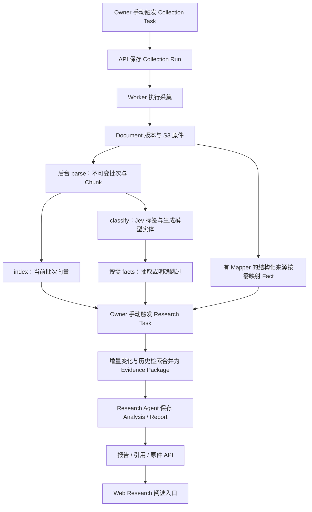

# 手动全链路审查结论

日期：2026-10-26。范围为手动触发的采集、后台处理、研究、报告及证据读取；不审查定时调度。

## 结论与证据边界

**同一批数据的内部手动闭环已在隔离服务器通过受控验收。官方 Jev 原生协议接入和独立配置已实现，随后通过 Magpie 完成一次真实官方 Jev 调用。真实来源与所有模型联合运行，以及浏览器呈现，仍未验证。**

验收使用真实 PostgreSQL/pgvector、真实 S3 字节保存与读取，以及现有 API、Worker 执行函数、解析、分类、Fact、选证和报告逻辑；来源和模型响应通过受控 HTTP transport 提供。报告具有正文、分析依据与对本批 Chunk/Fact 的真实关联，原件 SHA-256 一致，不能将此结果解释为真实投资研究或官方模型调用成功。

确认两处原有问题：MP-01 为自定义配置路径下的 API/Worker 不一致，MP-02 为历史语义证据漏带已有 Fact。默认配置的首次受控正常路径没有被这两项阻断；重复研究及自定义部署仍有条件性风险。本任务按审查授权记录它们，未修复。

## 链路与就绪条件



箭头表示数据使用关系，不表示四个后台阶段严格串行，也不表示每篇文章都必须产生 Fact。index 依赖 parse；文本 Fact 依赖可用分类与 `should_extract`，结构化来源可按其 Mapper 处理原始响应。`should_extract=false` 或不适用时应明确跳过，不能造 Fact 或把配置缺失当作不适用。

| 交接 | 入口与主体 | 产物及继续条件 |
| --- | --- | --- |
| 手动采集 | `POST /api/tasks/{task_id}/runs`；API 排队，Worker 执行 | Collection Run 及来源执行摘要；成功 Run 不等于所有条目完整，也不等于后台处理就绪 |
| 原文入库 | `collection/service.py` → `repository.py` | 同批 Document ID、不可变版本、内容哈希、S3 snapshot；代表性验收要求完整正文 |
| 后台处理 | `worker.py` → `processing/runner.py` 与 processors | 当前成功 parse batch、非空可定位 Chunk、分类标签、实体、当前向量、适用 Fact 或明确跳过 |
| 手动研究 | `POST /api/tasks/{research_task}/runs`；Executor 与 Research service | 研究 scope/query 能检索本批数据；选证包保存本批 Document、Chunk 及适用 Fact |
| 分析与报告 | Research Agent、确定性引用校验、持久化 | Analysis/Report 与成功 Run 关联，实际正文和发现引用本批证据 |
| 读取与展示 | Report、citation、original API → Research 页面 | 原文片段/版本可读，原件字节哈希一致；本轮 API 已验收，浏览器未验收 |

## 官方 Jev 接入结果

- 分类角色使用独立的 `typesafe` provider，调用 `POST /v1/systemone`，以 `model/state/questions` 发送原文数据和固定候选决策，读取 `answers/usage`。
- `choice` 处理类别和事件类型；`noul` 处理独立标签与抽取决策，按 `config/models.yaml` 中 `agents.classification.noul_threshold` 比较概率。候选来自 taxonomy，不用股票 Watchlist 过滤原文。
- `classification_entities` 显式使用生成模型抽取原文明示的公司、股票代码及原文依据，合并为现有 ClassificationDecision。这是必要的能力分工，不是 Jev 失败后自动换模型。
- 缺失/多余答案、错误类型、未知候选、非法概率、无依据实体、缺少配置及协议失败均明确失败；不写空分类成功。两次调用的身份、使用量和输入依据均保存。
- Jev 不提供文档化的开放文本股票代码抽取。仅选择预设候选不能代替发现未知代码。本次保留了原有开放实体能力。

在服务器配置以下变量，并使 API 与 Worker 使用相同的环境和模型配置：

```dotenv
CLASSIFICATION_API_BASE_URL=https://api.typesafe.ai/v1
CLASSIFICATION_MODEL_NAME=jev-latest
CLASSIFICATION_API_KEY=<在服务器填写>
```

`MODEL_*` 仍用于研究、文本 Fact 及实体生成，embedding 保持其独立配置。只配置 Jev 并不足以完成全部链路。生产配置说明以 `docs/execution.md`、`docs/quickstart.md` 为准；本轮没有修改生产凭据或部署服务。

用户随后授权使用 Magpie。指定服务器通过临时转发真实发现 `typesafe/jev-latest`，以当前适配器发送 36 个 taxonomy 问题，真实返回 `jev-1.14.0` 并通过严格答案/概率/用量校验：约 1.833 秒、4108 tokens。该调用使用虚构文章，不调用实体/研究/Fact/embedding；不能与受控完整 smoke 拼接成“所有真实外部依赖的闭环”。方法与清理见 `research/magpie-live.md`。

## 已确认问题与修复顺序

### MP-01：自定义路径下 API 与 Worker 使用不同配置（受影响部署 P1）

- **位置：** `backend/src/stocks/worker.py:112` 的 `WorkerContext.from_settings()` 固定 `config/tasks.yaml`、`config/models.yaml`、`config/sources.yaml`；同文件 `:567` 起 CLI 默认项重复固定路径；`compose.yaml` 的 Worker command 显式传入默认文件。API 在 `backend/src/stocks/api.py:1264`、`:1290` 等处读取 Settings 路径。
- **触发：** 使用 `MODELS_CONFIG_PATH`、`SOURCES_CONFIG_PATH` 或对应 Settings 覆盖路径，但没有同时给 Worker 传相同显式参数。未修改的默认路径一致，不能把该问题说成默认部署必坏。
- **影响：** API 可以按自定义来源/模型创建 Run，Worker 随后读另一份配置；可能找不到来源、拒绝模型快照或用错误处理配置，破坏手动排队到执行的交接。
- **运行证据：** `research/audit_probes.py::test_worker_honors_settings_config_paths` 在指定服务器失败，实际 context 为 `config/*.yaml`，期望为 Settings 中的 `custom/*.yaml`；见 `verification/audit-probes.log`。探针验证路径偏差，未另跑一次完整自定义部署。
- **最小建议：** Worker 默认值统一从 Settings 取得，保留显式 CLI 参数优先，并让 Compose 尊重同一配置来源。补一条 API/Worker 路径一致的定向回归。
- **当前绕行：** API 路径和 Worker 显式参数保持一致；只使用默认路径也不会触发该差异。

### MP-02：历史文档入选时漏带已经保存的 Fact（P2）

- **位置：** `backend/src/stocks/research/service.py:295` 仅为当前 change page 的 Document 加载 Fact；`:412` 历史语义命中调用 `EvidenceCollector.add_hit()` 未提供 Fact；`research/evidence.py:128` 只合并调用方传入的 Fact。后续 Agent 和报告比较只读取已冻结证据中的 Fact。
- **触发：** 文档已经完成 Fact 抽取，变化游标越过该文档；后续研究经语义检索将它作为历史背景选入，而当前变化页没有该文档的新变化。
- **影响：** 文本与 Chunk 仍可入选和引用，但已有结构化 Fact 从新证据包与 Agent 输入漏掉，指标比较可能为空。不是数据被删除，也不是所有后续报告都会失败。纯结构化且无文本向量的历史 Fact 另无等价的初始语义背景入口。
- **运行证据：** `research/audit_probes.py::test_historical_semantic_document_keeps_saved_facts` 在指定服务器失败：Document 被选入，但 `fact_refs` 实际为空，数据库已有预期 Fact。见 `verification/audit-probes.log`。这是受控选证服务复现，未包装成真实模型的第二次研究验收。
- **最小建议：** 对已选历史 Document 从现有 Repository 有界加载/合并其 Fact，保留 Fact 身份、原件版本与去重；另外核对结构化历史取材，不制造虚假向量或重抽 Fact。

建议先统一配置路径，再修复历史 Fact 合并，随后用实际密钥执行真实同批来源验收及第二次研究。两项修复均未在本任务实施，不借审查扩充证券主数据、迁移或调度系统。

## 同批数据验收证据

本批为**虚构受控文章**：Acme Holdings（ACME）2026 Q3 收入为 42 million USD，不是真实市场事实。生成模型返回正文和明确的资料限制，系统实际保存并读取报告。

| 产物 | 实际关联标识 |
| --- | --- |
| Collection Run | `bc8244eb-d9fe-4972-b195-d53a78ec2dcd` |
| Document / 版本 | `33d881ce-baf5-4adc-bece-200ccb1d2a17` / `1` |
| parse batch | `63ac95e4-330e-4892-b8cd-4f078c75912a` |
| Chunk（报告实际引用） | `25c75d5d-42a7-41b9-930e-c8d359ffdc53` |
| Fact | `bfb28d67-8655-4f3f-abe1-5d5ec0e003f5` |
| Research Run | `c43f5891-9d05-4107-93ce-cfdf06cd80b4` |
| Evidence Package | `e94ad821-6d83-4dbc-ba70-c2c38e191216` |
| Analysis | `b7003ba6-3c1e-4098-9f26-f6ca723f51a2` |
| Report | `d8ba52b2-1fda-4d14-b7e3-bf837714ac2c` |

Manifest 在 `verification/manual-smoke-manifest.json`；实际标签/实体在 `classification.json`；Agent 实际输入在 `research-input.json`；保存报告的读取响应在 `report-detail.json`；引用响应在 `citation.json`。这些文件均位于任务 `verification/`，只包含隔离受控数据。资源清理后上述 UUID 是验收记录，不能作为生产查询链接。

本次同时验证：重复触发排队中的采集 Task 返回同一个 Run，`created=false`；四个处理阶段完成；ACME 与公司名入库；Fact 数值及其 Chunk 依据对应；当前批次向量入 pgvector；研究输入和保存报告包含本批 Chunk/Fact；原件接口返回同一 SHA-256；语义搜索找到本批文档。

## 手动操作与诊断

1. 在服务器配置来源、Jev、生成模型、embedding、数据库和 S3；初始化当前结构，并启动 API 与 Worker。保证两者路径、环境和存储一致。来源 scope 与研究 query 必须能覆盖目标文章。
2. 在 Tasks 页触发采集（默认 `collect_enabled_sources`），保存 Run ID；在 Runs 查看来源摘要、失败条目和生成的 Document。不能只看顶层 `succeeded`。
3. 在 Document/Processing 看**这一批**的 parse、index、classify、facts。要求非空可读 Chunk、正确标签与实体、当前批次索引成功，以及适用 Fact 已保存或明确跳过。采集完成不表示这些阶段已经完成。
4. 再触发研究（如 `fed_policy_brief` 或按目标内容配置的 `saved_evidence_brief`），查看成功 Run、证据包及报告。不得用不匹配的默认研究范围验证任意公司文章。
5. 确认报告有实际分析，并点开报告实际引用的本批证据和原件。检查 Document 版本、Chunk 和 Fact 身份一致，不用仅有报告行或空证据报告作为成功证明。
6. 卡住时分别读 `GET /api/runs/{run_id}` 和 `GET /api/processing`；文档阶段失败使用 `POST /api/processing/retry` 排队恢复，Worker 才执行。遗留 running 的恢复先确认旧进程停止。研究过早触发时允许诚实的证据不足；处理就绪后重新研究，不把早先空报告当作本轮成功。

## 验证覆盖与未完成项

- 相关 Jev/classification/provider/worker 定向回归：113 passed；共享路由/embedding 定向回归：23 passed。
- 补充边界检查时命令换行错误，意外执行了一次全套后端 pytest：**642 passed，1 warning**。如实记录这一事实；没有把随后被 shell 当作命令的七个 node ID 记为单独运行成功，也没有再次重复测试。完整 pytest 已包含处理依赖、失败重试、Owner 重试、重复字节复用、分类失败不阻断索引、未完成 parse 拒绝引用和空选证诚实表达等已有用例。
- 全新隔离数据库初始化及模型一致性检查通过；受控完整 smoke 通过。两个原有问题的探针均按预期暴露缺陷，仍然是失败用例。
- 在远程隔离副本从 `.env.example` 建立临时 `.env` 后，`docker compose --env-file .env.example config --quiet` exit 0；未构建镜像或部署。
- **仍未验证：** 真实来源和生成/向量服务联合运行；浏览器呈现及点击；长期 Worker 进程生命周期；处理未就绪时提前触发完整真实研究；第二次真实研究的历史 Fact 复用。Jev 单独的官方实际请求已通过，账户配额与所有输入不在单次样例承诺内。定时调度排除在范围外。

实施与静态复核记录见 `research/jev-implementation.md`、`research/jev-review.md`、`research/manual-pipeline.md`；实际命令和限制见 `verification/README.md`。后续真实联合验收仍需可用的来源、生成与向量配置；单独 Jev 的真实协议验证已由 Magpie 完成，无需把上游密钥发入对话或仓库。
