# Manual application pipeline audit

## Scope and evidence status

Read-only source audit for `.trellis/tasks/10-26-application-pipeline-audit`. Read `AGENTS.md`, `.trellis/spec/guides/agent-execution-guide.md`, task PRD/design, relevant domain docs, implementation and tests. `python3 ./.trellis/scripts/task.py current --source` returned **none / Source: none**; the explicit task path in the dispatch identifies this audit's output location. No task state was changed.

Only this research file was written. Product code/configuration, production services and data were not changed. No local tests, AST checks, imports, database/API queries, remote calls or credential inspection were performed. All assertions below are **static code conclusions**, not successful runtime verification. The dedicated Jev integration is being edited by another agent and was excluded from proposed repairs. Timers/scheduling configuration and scheduler behavior are excluded.

## Confirmed defects

### MP-01 — Worker and API resolve different configuration files when config-path settings are overridden (P1 for affected deployments)

**Primary locations:**

- `backend/src/stocks/worker.py:112`, `:113`, `:114`: `WorkerContext.from_settings()` puts literal `config/tasks.yaml`, `config/models.yaml`, `config/sources.yaml` into its context instead of using the corresponding Settings values.
- `backend/src/stocks/worker.py:567`, `:572`, `:577`: Worker CLI defaults repeat the literal paths; `:687`–`:689` passes those defaults back as overrides, so fixing only `from_settings()` would not fix ordinary CLI startup.
- `compose.yaml:55`: shipped Worker command explicitly supplies the default files, independently of environment-backed Settings.
- API side: `backend/src/stocks/api.py:1264` loads `config.tasks_config_path`; `:1290` resolves the queued Run's model snapshot from `config.models_config_path`. Processing status/retry use these Settings at `:1089` and `:1211`; source loading uses `:4460`.
- Supported Settings fields: `backend/src/stocks/settings.py:34`–`:36`.
- Runtime handoff: `backend/src/stocks/worker.py:282`–`:283` passes the Worker's model/source paths into `ExecutionContext`; `backend/src/stocks/execution/service.py:1766` loads collection sources from that Worker-side source path.

**Trigger:** Owner configures `MODELS_CONFIG_PATH` and/or `SOURCES_CONFIG_PATH` for the API/Worker environment and starts the normal Worker command without matching explicit path overrides. The default paths all agree in the untouched repository, so this is conditional, not a claim that the shipped default files are different.

**Impact:** An API trigger can accept a Run using the custom model/source configuration, while the Worker reads different files. A custom collection source absent from the default source file cannot be collected. A research Run whose queued model aliases/providers differ from the Worker's defaults fails route/snapshot validation before useful analysis. Background classify/facts/index can likewise use the wrong model/source configuration; API status/retry can report a capability based on a different configuration than the executor actually uses. The manual API → Worker handoff is broken for this supported configuration mode.

**Minimal remote reproduction idea:** In an isolated test deployment, provide a custom models YAML at a second path with a route alias/model identity distinct from `config/models.yaml`, set `MODELS_CONFIG_PATH` to it for both processes, and create a research Run through the API. Start `python -m stocks.worker --once` without `--models-config`; inspect the recorded Run failure. Alternatively configure a source ID only in a custom `SOURCES_CONFIG_PATH`, enqueue a collection Task for that ID, and inspect the collection step. Supply matching explicit Worker flags as a control. No live provider call is needed if the route mismatch fails first. Do not print configuration values or secrets.

**Minimal repair direction (not implemented):** Derive Worker defaults from Settings while preserving explicit CLI overrides, and make the Compose command honor the same paths. Add one targeted remote test for API/Worker path agreement. Until repaired, use matching explicit Worker paths and align the API environment.

### MP-02 — Previously generated Facts disappear from later research when their Document is selected only as historical context (P2)

**Primary locations:**

- `backend/src/stocks/research/service.py:295`: `facts_for_documents()` runs only for `changed_document_ids` in the current incremental change page.
- `backend/src/stocks/research/service.py:323`: incremental `collector.add_hit()` supplies `facts=fact_refs`.
- `backend/src/stocks/research/service.py:412`: semantic/history `collector.add_hit()` supplies the hit, role/reason/match role, but no Facts.
- `backend/src/stocks/research/evidence.py:128`: `EvidenceCollector.add_hit()` merges Facts only when the caller supplies them; it does not look them up itself.
- `backend/src/stocks/research/service.py:845`: `merged_research_fact_refs()` can read only frozen Facts already included in evidence groups or adopted supplemental inputs.
- `backend/src/stocks/execution/service.py:2032`: `_agent_evidence()` uses that frozen set, so the missing Facts cannot reach the Agent, deterministic comparisons or saved report comparisons later in the pipeline.

**Trigger:** A Document has completed parsing, indexing and applicable Fact extraction. A successful research Run advances the Task's change cursor beyond those changes. A later manual Run for the same Task/scope retrieves that same Document through semantic background search, with no fresh changes for the Document in its current change page. The same omission occurs when a later scan page contains other Documents but semantic history retrieves an already-scanned Document.

**Impact:** The stored text can still be cited, but its existing structured Facts are absent from the new Evidence Package and Agent input. `fact_count`/metric comparisons can fall to zero even though the selected Document still has Facts in the Repository. Research no longer reuses the full stored evidence chain on repeat manual runs. This is not a claim that all later reports fail or that the original text disappears; it is a confirmed Fact → historical research handoff omission. A structured Fact-only Document additionally has no vector background path, so after its change has been scanned there is no initial-selection background query that can recover it.

**Contract:** `docs/research.md:38` says background selection reads historical Document/Fact without the incremental-window restriction. `docs/research.md:40` requires combined Document + Fact evidence to retain its structured fields and source linkage. `docs/research.md:110` describes the current code's incremental Facts plus semantic background implementation; that narrower implementation does not provide the historical Fact reuse promised by the preceding contract.

**Minimal remote reproduction idea:** Extend the fixtures in `backend/tests/test_incremental_evidence.py` with one parsed/indexed Document and one Fact. Make the semantic result deterministically return that Document. Compare selection in a window containing its Fact change against a later empty change window after cursor advancement. In both cases the Document is selected; currently only the first package contains the Fact. Assert the same Fact ID survives in the later package's group, Agent input and final comparison when applicable. A focused service test can demonstrate the omission without real providers; an API/Worker control can then verify it with the same Document ID.

**Minimal repair direction (not implemented):** Join/merge the stored Facts for semantic-selected Documents into the same frozen groups, preserving bounds, Fact IDs and deduplication. Handle structured historical Fact lookup through the existing repository rather than requiring a fake vector entry. Verify the later Run reuses the same Fact identity without re-extraction or marking old evidence as new.

## Important boundaries that are not new defects

- **Collection success is not processing readiness.** Collection commits Documents and creates their stage rows; processing runs independently. A successful Collection Run does not certify parse/classify/facts/index completion. This follows from `backend/src/stocks/repository.py:229` and `backend/src/stocks/worker.py:133` / `:195`.
- **Early research is permitted and may save an explicitly incomplete report.** `backend/tests/test_execution.py:1310` covers an empty-evidence Run succeeding with explicit gaps. Empty report success must not count as same-batch end-to-end acceptance.
- **Later processing emits new changes.** `backend/src/stocks/repository.py:1098` emits `document_parsed`; `:574` emits `document_indexed`; classification and new Facts also emit changes (`backend/src/stocks/classification/service.py`, `backend/src/stocks/extraction/service.py:807`). An early scan is not proof that later-completed text is permanently consumed. Confirm this remotely rather than reporting generic early-trigger data loss.
- **Fact-only finding citations are explicitly unsupported today.** `docs/research.md:131` applies the persistent-Chunk citation rule to initial and supplemental inputs. `backend/src/stocks/execution/service.py:2049` emits Agent evidence while iterating readable Chunk references; Fact-only groups do not become standalone finding references. A structured source chosen for the full citation smoke must produce a usable parsed Chunk, or the run will exercise this documented limitation. Do not invent a Chunk solely to pass the smoke.
- **`as_of` is not a strict historical replay cutoff.** `docs/research.md:37` expressly permits inputs acquired after startup, with honest timestamps. The absence of a universal startup-time filter is therefore not a defect for this task.
- **Classification failure does not prevent text recall by design.** `backend/tests/test_incremental_evidence.py:500` covers readable semantic evidence despite failed classification. For a complete applicable-Fact smoke, classification still needs to resolve `should_extract`, and its actual stage result must be inspected.
- **Not every article needs a Fact.** `backend/src/stocks/extraction/service.py:908` distinguishes mapped structured input, positive extraction decisions, negative decisions and undecided classification. A legitimate `NOT_APPLICABLE` skip after `should_extract=false` is a successful boundary, not lost data.
- **Worker `--once` processes at most one Document stage.** `backend/src/stocks/worker.py:173` runs one queued Run and one processing stage. A single zero-exit cycle is not a four-stage or research end-to-end verification. The long-running Worker has separate Run and Document slots.

## Happy-path sequence and prerequisites

These are code-backed operations and readiness criteria, not a record of an executed run.

```mermaid
flowchart LR
  A[Manual collection API] --> B[queued TaskRun]
  B --> C[Worker Run slot]
  C --> D[Document version + original snapshot + four stage rows]
  D --> E[Worker Document slot: parse]
  E --> F[classify + index]
  F --> G[applicable facts]
  G --> H[Manual research API]
  H --> I[Worker: freeze change window and EvidencePackage]
  I --> J[Research Agent + validate citations]
  J --> K[Analysis + Report persisted]
  K --> L[Report API and frontend citation/original]
```



Facts and index are not a mandatory serial chain: index depends on parse; text extraction waits for the classifier's decision; a configured structured mapper can read raw stored bytes directly. `backend/src/stocks/processing/stages.py:49` defines these dependencies.

Prerequisites:

1. Current-schema PostgreSQL/pgvector database initialized in the task's isolated remote environment; API and Worker must use the same database, original storage and aligned configuration paths.
2. S3-compatible bucket/endpoint and credentials available to ingestion and original retrieval; readable raw bytes must remain accessible. API health alone does not prove storage access.
3. Enabled configured source(s), reachable permitted HTTPS URLs and suitable user-agent/access configuration. A failed article fetch can preserve only feed title/summary as `partial`; use a genuinely complete document for the representative full-body run.
4. Working embedding route with the repository's fixed vector dimensions, working research route and the dedicated classification/entity routes after the other agent's integration. If extraction is applicable, a working generation route for `fact_extraction`; if mapping structured data, a valid mapper for that Source.
5. Worker process running with both Run and Document capacity. The API only queues a Run; it does not execute it. Long-running Worker slots can process documents while a research Run is busy.
6. Owner authentication/session configured for protected APIs and normal browser CSRF handling. Do not expose an unauthenticated alternate API for the smoke.

Representative manual flow:

| Stage | Operation / code anchor | Required proof before proceeding |
| --- | --- | --- |
| Trigger collection | `POST /api/tasks/collect_enabled_sources/runs`; `backend/src/stocks/api.py:1253` | Save returned Collection Run ID. Repeated trigger while queued/running returns the active Run (`created=false`). |
| Execute collection | Worker claim: `backend/src/stocks/worker.py:144`; Run collection step: `backend/src/stocks/execution/service.py:1736` | Inspect Run/step source summaries, failure counts and per-item Document IDs. Per-item failures can coexist with a succeeded Run. |
| Preserve actual evidence | `collect_source()` at `backend/src/stocks/collection/service.py:97`; `ingest_document()` at `backend/src/stocks/repository.py:155` | One batch Document ID, content hash, snapshot key, immutable version, complete content, original URL/timestamps. Identical payload reuse should preserve identity; changed bytes create a new version. |
| Parse | Lazy registry: `backend/src/stocks/processing/processors.py:299`; parser service: `backend/src/stocks/processing/service.py:68` | Successful parse batch ID and nonempty locator-bearing Chunk IDs on that same Document. Stored-byte hash verified by parse. |
| Classify / index / applicable Fact | Stage dependencies: `backend/src/stocks/processing/stages.py:49`; registry: `backend/src/stocks/processing/processors.py:299` | Classification succeeds with actual tags and `should_extract`; index is completed for current parse batch; if extraction applies, persist actual Fact IDs and evidence refs, otherwise record the explicit justified skip. Use `GET /api/processing` and Document detail to inspect this batch rather than wait for the entire global backlog. |
| Trigger research | `POST /api/tasks/fed_policy_brief/runs` (or `saved_evidence_brief`); shipped Tasks at `config/tasks.yaml:17` / `:48` | Save Research Run ID; use a Task/query/source scope that can actually retrieve the batch. A queued trigger is not a successful model run. |
| Freeze evidence | `backend/src/stocks/execution/service.py:794` binds the change window; `:1628` selects evidence; `backend/src/stocks/research/service.py:283` merges incremental documents/Facts then background text | Save Evidence Package ID, window watermarks, selected batch Document + parse batch + Chunk IDs, applicable Fact IDs. Bounded/truncated scan has continuation state, not proof of exhaustive coverage. |
| Analyze and persist | `_agent_evidence()` at `backend/src/stocks/execution/service.py:1999`; `_run_agent()` at `:2312`; `_analysis_and_report()` at `:2653` | Nonempty useful analysis with at least one genuine reference to the batch. Analysis/Report are persisted with the succeeded research step; illegal/fabricated references fail validation. Save Analysis and Report IDs. |
| Retrieve citation | `GET /api/reports/{report_id}` at `backend/src/stocks/api.py:1924`; evidence endpoint at `:2125`; original endpoint at `:1703` | Selected and actually cited IDs agree; exact stored Chunk text/version and original bytes can be fetched, with matching hash. Fact projection is present when applicable. |
| Display | `frontend/src/features/research/research-page.tsx:375`; `frontend/src/features/research/research-article.tsx:62` | Article renders actual sections/findings, citation dialog opens the saved evidence, and its original link works. A report row without these batch citations does not satisfy acceptance. |

Recovery entry points, without production repair:

- `GET /api/runs/{run_id}` and `GET /api/processing` expose separate Run failures and Document-stage failures. API locations: `backend/src/stocks/api.py:974`, `:1072`.
- Document retry: `POST /api/processing/retry` at `backend/src/stocks/api.py:1186` reopens selected stages for Worker execution. Retry does not re-execute a completed stage. Explicit reprocess is a different CLI operation. A stage left running requires confirmation that the prior process stopped.
- Run retry: `POST /api/runs/{run_id}/retry` at `backend/src/stocks/api.py:1307`; preserved successful steps/evidence can be reused. Do not claim recovery by starting a second live owner.
- All failure injection, cleanup and runtime commands belong to the main agent's isolated directory on `100.120.14.84`.

## Useful existing remote tests / smoke harnesses

Nothing in this section was executed by this audit.

| Artifact | Useful coverage | Limits for this task |
| --- | --- | --- |
| `backend/tests/v1_02_processing_smoke.py:251` | Executable manual smoke, not pytest-collected. Seeds a real stored HTML Document, drives actual `stocks.worker --once` / `stocks.processing` subprocesses, checks parse/current chunks, index routing failure, retries/reprocess and later deterministic embedding completion. Its header at `:1` describes intended scope. | No real model calls; deliberately broken model configuration and fixed embeddings. Does not prove collection API → dedicated classifier → applicable extraction → research/report/frontend on one batch. Use only in the isolated task DB; its reset is scoped to its smoke Source/dedupe key. A new classification adapter may require revisiting its assumptions before reusing it unchanged. |
| `backend/tests/test_scheduler.py:718` (`test_worker_run_once_executes_collection_without_model_credentials`) | Collection Task/Worker orchestration and Run output with a stubbed `collect_source` summary; useful despite its filename. | Select this one test with `-k` if useful; no scheduler critique or broad scheduler suite is needed. This test does not perform actual Document storage and is not same-data collection acceptance. |
| `backend/tests/test_collection.py:944`, `:1115` | Complete article ingest, unchanged skip, failed fetch → partial evidence → retry. | Controlled HTTP/storage fixtures. |
| `backend/tests/test_worker_processing.py:257`, `:323` | One-stage Worker cycle and Document slot progress while a Run slot is busy. | Concurrency/queue behavior rather than complete business pipeline. |
| `backend/tests/test_processing_retry.py`, `backend/tests/test_facts.py` | Stage recovery/reprocess and applicable extraction/mapping behavior. | Pick the relevant scenario; do not run the whole repository by default. |
| `backend/tests/test_execution.py:1161` (`test_successful_run_persists_snapshot_steps_and_never_overwrites_success`) | Research execution, Evidence Package/step/Analysis/Report persistence. | Controlled transports/seeded evidence; not real collection and dedicated classifier acceptance. |
| `backend/tests/test_execution.py:1748`, `:2031` | Frozen adopted Facts/comparisons reach Agent; complete research Run records model identity and reported cost. | Does not cover MP-02's later semantic-only background omission. |
| `backend/tests/test_execution.py:2356`, `:2450`, `:2786` | Retry preserves window/input, superseded parse batch remains readable, fabricated citation fails without overwriting previous report. | Focused failure boundaries. |
| `backend/tests/test_incremental_evidence.py:403`, `:500` | Incremental + semantic deduplication, Fact merging while Document is in current window, recall despite classifier failure. | A later-window historical Fact regression test is still needed for MP-02. |
| `backend/tests/test_report_api.py:455`, `:619`, `:659`, `:869` | Saved versions remain readable after source update, original bytes/hash and download behavior, non-package evidence rejection, adopted Fact snapshots. | Fixture reports do not prove the current batch was used by the real research model. |
| `backend/tests/ac3_drill.py:833` | Real Worker subprocess kill/end/retry drill reuses Evidence Package and completes Analysis/Report without duplicate evidence. | Owner-confirmed interruption drill, manual only, controlled `httpx.MockTransport`; memory-backed seed storage means it is not the original-object retrieval smoke. Keep separate from first happy-path acceptance. |
| `frontend/src/features/research/research-page.test.tsx` | Existing UI report/citation behavior tests. | Component fixtures, not browser-to-live-backend E2E. Confirmed actual browser citation/original retrieval remains for the main agent. |

Suggested narrow remote validation order: finish the dedicated classification integration; use existing controlled processing/research tests to establish internal compatibility; then run one same-batch manual flow with the exact IDs recorded above; exercise early research and one applicable stage failure/retry only after the normal path. Reuse the existing harnesses for their specific guarantees and do not label their separate successes a live application end-to-end success.

## Completion / handoff

This bounded static audit is complete. Confirmed issues: MP-01 (conditional API/Worker configuration disagreement) and MP-02 (historical Fact handoff omission). No product repair was performed or authorized by this artifact. Remote same-batch verification, actual model/source availability and browser retrieval remain unverified and belong to the main agent. No runtime/background process or remote resource was started by this audit.


## Follow-up: smallest viable same-data controlled smoke harness

Created `research/manual_pipeline_smoke.py` at the parent request. A complete controlled backend harness is realistically achievable in this batch and the script is ready for transfer, but it has **not been executed, compiled, AST-checked or tested locally**. Remote execution is required to establish whether it passes. It uses the current native Jev `questions`/`answers` contract and the explicit `classification_entities` generation role observed in the other agent's working tree.

The smallest useful scenario is one controlled RSS item containing one HTML article with an explicit company/ticker and one numeric quarterly revenue statement. A positive Jev extraction decision makes all four processing stages applicable. The same Document/Chunk/Fact then enters the real first-window selection and real report validation. This covers more of the pipeline than a negative extraction decision or separately seeded research evidence would cover.

**Actual execution path:** authenticated `TestClient` login/CSRF → API manual collection trigger and duplicate trigger → `worker.execute_next_run()` claim and collection execution → actual `SafeFetcher` body handling and `ingest_document()` → actual S3 put/get → bounded `execute_next_document_stage()` calls → real parse, native Jev normalization, entity validation, Fact extraction/validation/persistence, embedding persistence → API manual research trigger → Worker selection (including actual pgvector query), Agent validation and Analysis/Report persistence → report detail, citation, original bytes/download and semantic-search API checks. It uses the Worker's real execution functions directly to avoid scheduling work in this manual-only scenario; it does not launch a Worker subprocess or test process polling.

**Controlled boundaries:** collection `SafeFetcher` construction is injected with supported DNS/HTTP transports; `WorkerContext.model_transport` receives `httpx.MockTransport`; API semantic search receives its real embedding-client loader with only the supported transport argument supplied. No parser, classifier, extractor, ingest, selection, database/storage result, citation check or report result is replaced. Model responses are deterministic controlled fixtures; source/model request hosts and paths are bounded to fixture domains. Original S3 storage and PostgreSQL/pgvector are real. Matching explicit Worker config paths avoid MP-01 for the normal-path smoke without fixing it.

**Remote prerequisites:** current schema and pgvector already initialized by main; runtime environment exported from the prepared `/tmp/stocks-v0-application-pipeline-audit-jev/runtime.env`; `TEST_DATABASE_URL` points to loopback PostgreSQL port `15547`; `S3_ENDPOINT_URL` points to loopback port `18347`; Settings-compatible `S3_ACCESS_KEY` / `S3_SECRET_KEY` available. No unrelated queued/running Run or unfinished Document backlog may exist in that isolated DB. Stop any competing task Worker first. The script refuses mismatched endpoints, does not initialize/drop/delete database objects, and does not read runtime.env itself or print credentials.

From the **remote repository root**, after main exports that environment:

```bash
PYTHONPATH=backend/src .venv/bin/python .trellis/tasks/10-26-application-pipeline-audit/research/manual_pipeline_smoke.py
```

Use the remote environment's actual Python path if it differs. The harness creates a unique bucket, Source and Task IDs; generated YAML, same-data IDs, processing checkpoints, report/citation payloads and observed research input are written under `research/smoke-output-<nonce>/`. Model configuration artifacts contain only dummy fixture credentials. Owner login secrets remain process-local. A bounded failure writes the last completed stage, fixed failure code/type and manifest path without dumping arbitrary exception messages. Main owns resource cleanup; the harness intentionally retains its bucket/rows and partial outputs for inspection. Its happy path does not repair MP-01/MP-02 or perform production recovery.

**Required successful evidence:** `manifest.json` must say `status=passed`, carry the same Collection Run → Document/version/hash/snapshot → parse batch/Chunk → Fact → Research Run → Evidence Package → Analysis → Report IDs, and record calls to native Jev, entities, extraction, embedding and research. Report citation and original bytes must resolve to that batch. A failed/empty research report does not pass. `external_success=false` is always preserved. Browser rendering and real external source/Jev/generation-provider calls remain outside this controlled result, even if the harness passes.


### Final bounded compatibility pass

Re-read the completed harness against the current working-tree Jev adapter at handoff. The transport fixture matches `decision.py` native state/excerpt/questions calls and separate `classification_entities` messages. It supplies every question ID, choice criteria probabilities/confidence, typed noul values, matching reported model and `input_tokens`/`output_tokens` usage required by `providers.py`. The generation fixtures return source-backed entity quotes and dynamically cite the actual parsed Chunk IDs passed to Fact/research calls. No signature adjustment was needed. This is a static compatibility check only; runtime success is still unverified. The harness is complete for its bounded controlled backend scope, and no further audit expansion or MP-02 reproduction was attempted in this batch.
